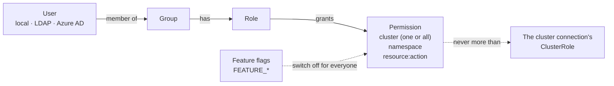

# Access model

**You want to:** understand what decides what someone can see and do, before you hand out access.

- **A permission** is four things: a **cluster** (one, or *all clusters*), a **namespace**, a **resource** and an
  **action**, e.g. *staging · shop · `deployments:restart`*. The full list of resources and actions:
  [Application permissions](/reference/permissions).
- **A role** is a named set of permissions (`shop-developer`). **A group** is a set of users that gets one or more
  roles. A user gets permissions **only through groups**; a user in no group sees nothing.
- **Several roles add up.** There is no "deny": a permission from any of a user's roles counts.
- **Namespaces are always named.** A permission names one namespace; there is no "every namespace" wildcard. A role
  for "all namespaces" lists each one (the role editor's *Select N matching* picks them in one go), and a namespace
  created later has to be added.
- **Discovery follows permissions.** The namespace list, the Dashboard tabs and Live Events show only what the user
  holds at least one permission for on their current cluster. Other names are never sent to the browser.
- **Changes apply on the next click.** Adding or removing a role, group or membership doesn't need a new sign-in.

## Admins

An **admin** holds every permission everywhere, sees every cluster and is the only one who can open Overview, Nodes
and Admin (users, roles, clusters, audit log, recordings, settings). Admin is all or nothing: there is no "user
manager" or "audit reader" role. Keep the number of admins small and give everyone else roles.

## Two ceilings above every role

1. **The cluster connection.** OpenConsole acts on a cluster with one identity (usually the `openconsole-reader`
   ServiceAccount). What its ClusterRole doesn't allow fails for everyone, admins included, with a Kubernetes 403
   ([Connect a cluster](/installation/connect-cluster#what-each-clusterrole-rule-is-for)).
2. **Feature flags.** `FEATURE_POD_EXEC=false` and the other `FEATURE_*` variables switch a capability off **for
   everyone, admins included**, whatever the roles say ([Customization and feature flags](/administration/customization-and-flags)).

API keys add a third, per user: the admin's [API access policy](/administration/api-access-policy) limits how much of a
user's permissions their keys may use.

## Everything is audited

Every allowed and every refused action is an audit event with the user, the cluster, the namespace, the resource and
the outcome ([Audit log](/administration/audit-log)). A refused attempt is `denied` with a reason, so a missing
permission shows up there before the user asks.

Next: [Recipes](/administration/recipes) for common teams, then [Roles and permissions](/administration/roles) for
the screens.
