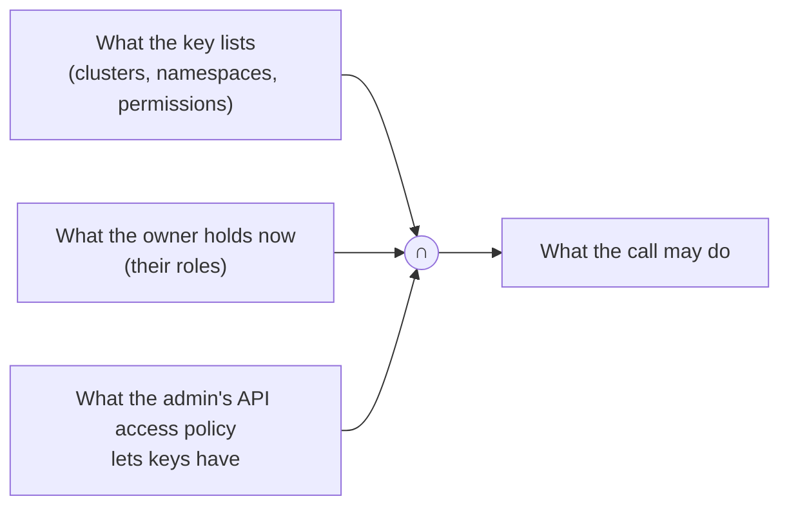

# API and agents

An **API key** lets a script or an AI agent (Claude Code, Cursor, a shell script) call the OpenConsole API in your
name. It is the same API the web UI uses, described in OpenAPI 3.1 at `GET /api/openapi.json` (no sign-in) and on the
[endpoint reference](/api/endpoints/openconsole-api).

- **Get started:** [Quick start](/api/quick-start) (first calls with `curl`), [Agent recipes](/api/agent-recipes)
  (Claude Code, Cursor, a shell script), [Limits](/api/limits).
- **Create and manage keys:** [Your API keys](/user-guide/api-keys) (user guide). **Decide what keys may do:**
  [API access policy](/administration/api-access-policy) (admins).

## What a key can reach

A key never reaches more than three things allow at the moment of each call, all at once:

- **The key's own scope:** clusters (all or one), namespaces (all of the owner's, including ones they get later, or a
  selection) and permissions, picked when the key is created.
- **The owner's permissions now:** take a namespace from the owner's role and their keys lose it on the next call;
  give the owner more and their keys don't grow on their own.
- **The API access policy:** per role *Off*, *Safe read-only* (the default: `list`, `get`, `logs`, no ConfigMaps or
  Secrets) or *All of the role's permissions*, and an optional per-user override.

A call outside any of them is refused with 403 and a reason in the body: `forbidden` (not in the key or not held),
`api_access_policy` (held, but the policy keeps it from keys), `api_access_off` (the policy gives this user's keys
nothing), `feature_disabled` (switched off by the operator). The full list is in [Quick start](/api/quick-start#errors).

**A key can never** create or change keys, change a password, change your selected cluster or save views (403
`api_key_not_allowed`); admin endpoints (`/api/admin/*`) need an admin's key made with the **Admin API** box.

## What is recorded

- **Audit:** every action and every resource read made with a key is an audit event with your user **and the key's
  name** (`api_key_name`; `openconsole.api_key.name` in ECS). Helper calls (`/api/auth/me`, `/api/ws-ticket`,
  `/api/features`, `/api/openapi.json`) are not audited; the request log still has them. See
  [Audit events](/reference/audit-events).
- **Shells and commands** run with a key are always recorded, even when recording is switched off for web sessions,
  and refused (503 `recording_unavailable`) when they can't be.
- **Key events:** `api_key.create`, `update`, `regenerate`, `revoke`, `delete`, and `api_key.use` when a key is
  refused or rate limited.

## Keep the key out of the prompt

Put the key in an environment variable (`OPENCONSOLE_API_KEY`) where the agent runs, never in a prompt, a file in
the repository or a URL. OpenConsole never accepts a key in a URL; WebSockets take a single-use ticket instead
([Limits](/api/limits#websockets)). The recipes keep the key out of the commands the agent writes, so it never shows
up in a transcript.
