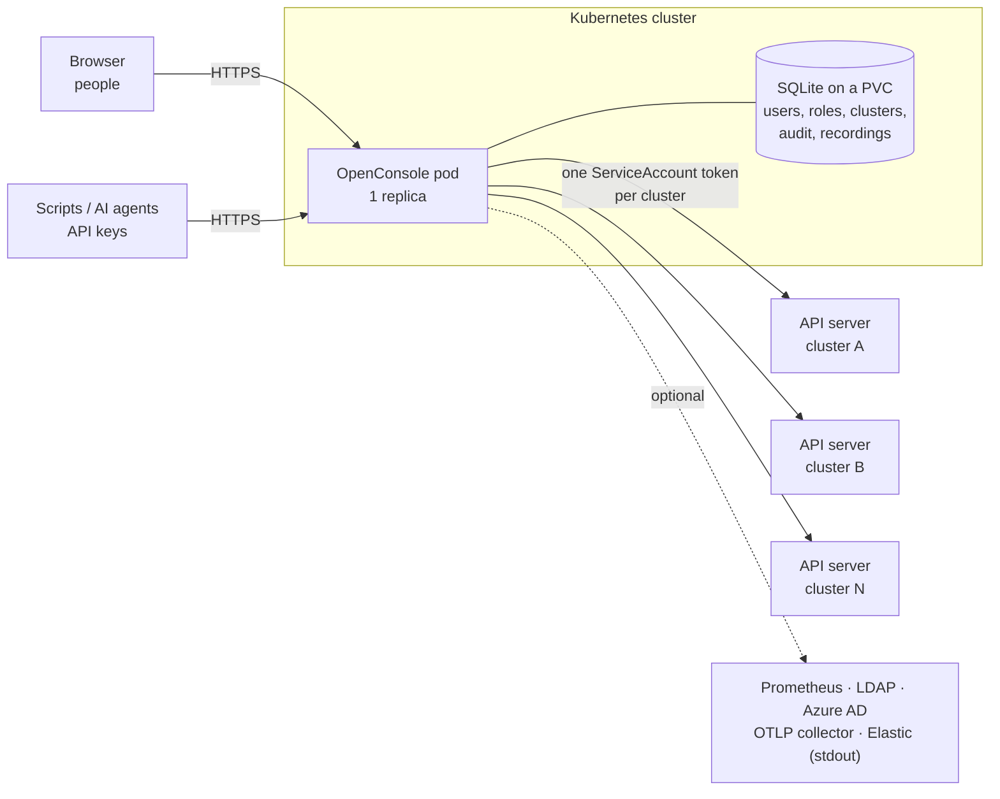

# Introduction

Kubernetes OpenConsole is a web console for several Kubernetes clusters. People sign in with a local, LDAP or
Azure AD account and see, and if their role allows, operate the workloads of the namespaces they were given:
pod status and logs, a shell, restart and scale, YAML edit, Secrets. Every action and every read is audited.
Scripts and AI agents use the same rules through a REST API with scoped API keys.

**Who it is for:** platform teams that want to give developers, support and on-call staff a view into the
clusters without handing out kubeconfigs, and want one place that records who looked at or changed what.

## How it works

- **One identity per cluster.** OpenConsole talks to each cluster with one ServiceAccount token (or a
  kubeconfig) that an admin adds in the UI. Its ClusterRole is the ceiling: no one can do more than it allows.
  People never get Kubernetes credentials.
- **Access is granted in the app.** User → group → role → permission, where a permission is a cluster, a
  namespace, a resource and an action (`pods:logs`, `deployments:restart`, `secrets:reveal`, …). A user only
  sees the namespaces they hold a permission in. Admins have everything.
- **Everything is audited.** Each read and write is one event with who, from where, what, on which cluster and
  the outcome, kept in the database (Admin → Audit Logs, CSV) and written to stdout as one JSON line for your log
  pipeline. Pod shells are recorded and can be replayed.
- **One container, one database.** A single Go binary serves the API and the web UI. State is a SQLite file on
  a ReadWriteOnce volume, so OpenConsole runs as **exactly one replica**.
- **Live data.** OpenConsole watches each cluster (informers), so lists come from memory and the API server is
  not polled. CPU and memory come from metrics-server, longer history from Prometheus if you configure it.

## What it is not

- **Not a replacement for `kubectl`.** It covers looking, logs, a shell, restart, scale and YAML edits of the
  common workload kinds. Cluster administration (nodes, RBAC, CRDs, storage) stays with your usual tools.
- **Not a provisioning or GitOps tool.** It does not create clusters, install charts or reconcile Git. An edit made
  in OpenConsole is a direct change, which your GitOps tool may undo.
- **Not a Kubernetes security boundary.** It is an internal visibility and operations platform. It enforces its
  own permissions within what its ServiceAccount may do; it does not change what Kubernetes allows anyone else.

## Where to go next

| You want to | Read |
|---|---|
| See it running in two minutes, without a cluster of your own | [Quick start (Docker)](/getting-started/quick-start) |
| Try every screen on a local cluster with failing pods | [Try it on k3d](/getting-started/try-on-k3d) |
| Install it for your team | [Install on Kubernetes](/installation/kubernetes), then [Connect a cluster](/installation/connect-cluster) and [First login](/getting-started/first-login) |
| Know everything it does | [Features](/features) |
