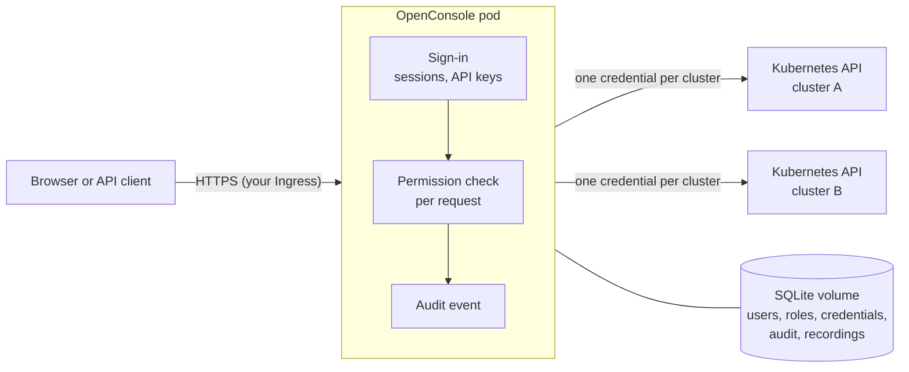

# Security model

This page describes how OpenConsole 2.22.0 protects the clusters it connects to, for a security review. Every
statement links to the code or manifest line that implements it (tag `v2.22.0`). What an operator should set up
around it is in the [Production hardening checklist](/operations/hardening).

## What OpenConsole can reach in a cluster

- **Only what an admin connects.** OpenConsole talks to a cluster only with the credentials an admin adds under
  Admin → Clusters (a ServiceAccount token or a kubeconfig). It finds no cluster on its own and doesn't use the
  pod's own identity: the manifest mounts no ServiceAccount token into the pod
  ([deployment.yaml#L24](https://github.com/vurulkan/kubernetes-openconsole/blob/v2.22.0/deploy/deployment.yaml#L24)).
- **The ClusterRole you give that credential is the upper bound** for everyone, admins included. The manifest's
  ClusterRole ([rbac.yaml#L34-L120](https://github.com/vurulkan/kubernetes-openconsole/blob/v2.22.0/deploy/rbac.yaml#L34-L120)) reads workloads, pods, services, config maps,
  events, nodes and metrics; reads and updates Secrets; reads pod logs; creates `pods/exec`; updates and patches
  workloads (YAML apply, restart, scale). It has no `create` or `delete` on any object, and no `services/proxy`
  unless you uncomment it for Prometheus. A view-only variant without any write verb is
  [rbac-readonly.yaml](https://github.com/vurulkan/kubernetes-openconsole/blob/v2.22.0/deploy/rbac-readonly.yaml#L30). Every rule and the feature it serves:
  [Kubernetes permissions](/reference/kubernetes-permissions).
- **Kubernetes sees OpenConsole, not the person.** The API server's audit log shows the connected identity for
  every user's action. Who did it is in OpenConsole's own audit log ([below](#what-is-recorded)).
- **Secrets are read on demand.** Lists and workloads come from an in-memory watch cache; Secrets are not watched or
  cached and are fetched from the API server for each request ([resources.go#L521-L540](https://github.com/vurulkan/kubernetes-openconsole/blob/v2.22.0/backend/internal/kube/resources.go#L521-L540),
  the rule's comment [rbac.yaml#L44-L47](https://github.com/vurulkan/kubernetes-openconsole/blob/v2.22.0/deploy/rbac.yaml#L44-L47)).

## Who may do what

- **Permissions are granted in OpenConsole**, per role: a resource and an action (`pods:exec`, `secrets:reveal`, …)
  in a namespace, on one cluster or all of them ([engine.go#L13-L28](https://github.com/vurulkan/kubernetes-openconsole/blob/v2.22.0/backend/internal/rbac/engine.go#L13-L28)).
  Users get roles through groups. Admins hold every permission
  ([router.go#L2587-L2599](https://github.com/vurulkan/kubernetes-openconsole/blob/v2.22.0/backend/internal/api/router.go#L2587-L2599)). The catalog:
  [Permissions](/reference/permissions).
- **The server checks every request.** Each handler calls one check
  ([`requirePermission`, router.go#L2631-L2654](https://github.com/vurulkan/kubernetes-openconsole/blob/v2.22.0/backend/internal/api/router.go#L2631-L2654)), which evaluates the
  caller's grants for the request's cluster and namespace ([`Can`, engine.go#L151](https://github.com/vurulkan/kubernetes-openconsole/blob/v2.22.0/backend/internal/rbac/engine.go#L151)).
  The UI hides what you can't use, but hiding is not the control. A refusal answers `403` with a reason code and is
  audited as `denied`. Admin screens use one admin check
  ([`isAdminRequest`, router.go#L611-L620](https://github.com/vurulkan/kubernetes-openconsole/blob/v2.22.0/backend/internal/api/router.go#L611-L620)).
- **A user who hasn't changed the initial password** gets no permission at all
  ([router.go#L2563-L2570](https://github.com/vurulkan/kubernetes-openconsole/blob/v2.22.0/backend/internal/api/router.go#L2563-L2570)), and an admin in that state is not an admin
  ([router.go#L613](https://github.com/vurulkan/kubernetes-openconsole/blob/v2.22.0/backend/internal/api/router.go#L613)).
- **Feature flags switch a capability off for everyone**, admins included, at the same check: `FEATURE_POD_EXEC`,
  `FEATURE_SECRET_REVEAL`, `FEATURE_API_KEYS`, … ([features.go#L49](https://github.com/vurulkan/kubernetes-openconsole/blob/v2.22.0/backend/internal/api/features.go#L49),
  [router.go#L2636-L2640](https://github.com/vurulkan/kubernetes-openconsole/blob/v2.22.0/backend/internal/api/router.go#L2636-L2640)).
- **An API key is never more than its owner.** What a key may do is what the key lists, intersected with what its
  owner holds now, intersected with the admin's API access policy
  ([router.go#L2574-L2584](https://github.com/vurulkan/kubernetes-openconsole/blob/v2.22.0/backend/internal/api/router.go#L2574-L2584),
  [`WithKey`, engine.go#L67](https://github.com/vurulkan/kubernetes-openconsole/blob/v2.22.0/backend/internal/rbac/engine.go#L67),
  [`KeyCeiling`, policy.go#L57](https://github.com/vurulkan/kubernetes-openconsole/blob/v2.22.0/backend/internal/rbac/policy.go#L57)). The default policy for roles is *safe
  read-only*: list, get and logs, without ConfigMaps or Secrets ([`SafeRead`, policy.go#L24](https://github.com/vurulkan/kubernetes-openconsole/blob/v2.22.0/backend/internal/rbac/policy.go#L24)).
  A key can never manage keys, change a password, pick the user's cluster or save views
  ([`denyAPIKey`, apikeys.go#L244](https://github.com/vurulkan/kubernetes-openconsole/blob/v2.22.0/backend/internal/api/apikeys.go#L244)).

## Sign-in and sessions

- **Local passwords** are stored as bcrypt hashes ([password.go#L12](https://github.com/vurulkan/kubernetes-openconsole/blob/v2.22.0/backend/internal/auth/password.go#L12)), at least
  `PASSWORD_MIN_LENGTH` (8) characters and at most 72 bytes ([password.go#L23-L35](https://github.com/vurulkan/kubernetes-openconsole/blob/v2.22.0/backend/internal/auth/password.go#L23-L35)).
  LDAP accounts are checked by a bind against the directory; Azure AD accounts sign in through Microsoft and never
  accept a local password ([router.go#L656-L681](https://github.com/vurulkan/kubernetes-openconsole/blob/v2.22.0/backend/internal/api/router.go#L656-L681)).
- **Guessing is slowed down:** after 5 failed sign-ins for one user name from one client address, that pair is locked
  for 5 minutes (`429`, audited as `user.login` `locked`)
  ([observability.go#L62-L67](https://github.com/vurulkan/kubernetes-openconsole/blob/v2.22.0/backend/internal/api/observability.go#L62-L67),
  [router.go#L632-L638](https://github.com/vurulkan/kubernetes-openconsole/blob/v2.22.0/backend/internal/api/router.go#L632-L638)). Every failed sign-in gets the same `401`, so
  the answer doesn't tell whether the account exists ([router.go#L684-L690](https://github.com/vurulkan/kubernetes-openconsole/blob/v2.22.0/backend/internal/api/router.go#L684-L690)).
- **Sessions** are signed tokens (JWT, HS256) with a lifetime from Admin → Sessions (60 minutes by default)
  ([jwt.go#L23-L35](https://github.com/vurulkan/kubernetes-openconsole/blob/v2.22.0/backend/internal/auth/jwt.go#L23-L35), [db.go#L344](https://github.com/vurulkan/kubernetes-openconsole/blob/v2.22.0/backend/internal/db/db.go#L344)). Each
  token has a server-side record that is checked on every request, so an admin can revoke one session or all of a
  user's sessions before they expire ([router.go#L95-L109](https://github.com/vurulkan/kubernetes-openconsole/blob/v2.22.0/backend/internal/api/router.go#L95-L109)). A
  deactivated user is refused on the next request ([router.go#L2668-L2678](https://github.com/vurulkan/kubernetes-openconsole/blob/v2.22.0/backend/internal/api/router.go#L2668-L2678)).
- **The browser keeps the session token in local storage** and sends it as an `Authorization: Bearer` header
  ([api.ts#L78](https://github.com/vurulkan/kubernetes-openconsole/blob/v2.22.0/frontend/src/services/api.ts#L78), [api.ts#L112](https://github.com/vurulkan/kubernetes-openconsole/blob/v2.22.0/frontend/src/services/api.ts#L112)); there are
  no session cookies.
- **WebSockets** (logs, shell, live events) never carry the session token in their URL. The page first asks for a
  ticket that works once, within 30 seconds, for one path only
  ([ticket.go#L11-L50](https://github.com/vurulkan/kubernetes-openconsole/blob/v2.22.0/backend/internal/auth/ticket.go#L11-L50)).
- **API keys** start with `oc_` so secret scanners recognise them ([middleware.go#L37-L38](https://github.com/vurulkan/kubernetes-openconsole/blob/v2.22.0/backend/internal/auth/middleware.go#L37-L38)).
  The secret is shown once; the database keeps its SHA-256 digest
  ([apikeys.go#L70-L74](https://github.com/vurulkan/kubernetes-openconsole/blob/v2.22.0/backend/internal/api/apikeys.go#L70-L74)). Keys expire (the admin sets the longest
  lifetime), can be revoked by their owner or an admin, and are limited to 10 requests per second each, bursts of 30
  ([apikeys.go#L43-L44](https://github.com/vurulkan/kubernetes-openconsole/blob/v2.22.0/backend/internal/api/apikeys.go#L43-L44)).

## Where data is kept

Everything OpenConsole stores is in one SQLite database on its volume (`/data/app.db`), plus shell recordings in
`/data/recordings`: users and password hashes, groups, roles, cluster credentials, LDAP and Azure AD settings,
Prometheus settings, sessions, API key digests and the audit log.

- **Credentials are encrypted** before they are written: cluster tokens, kubeconfigs and CA certificates
  ([clusters.go#L100-L111](https://github.com/vurulkan/kubernetes-openconsole/blob/v2.22.0/backend/internal/store/clusters.go#L100-L111)), the LDAP bind password
  ([store.go#L489](https://github.com/vurulkan/kubernetes-openconsole/blob/v2.22.0/backend/internal/store/store.go#L489)), the Azure AD client secret
  ([store.go#L571](https://github.com/vurulkan/kubernetes-openconsole/blob/v2.22.0/backend/internal/store/store.go#L571)) and Prometheus settings
  ([clusters.go#L235-L245](https://github.com/vurulkan/kubernetes-openconsole/blob/v2.22.0/backend/internal/store/clusters.go#L235-L245)), with AES-256-GCM and a random nonce per
  value ([crypto.go#L12-L30](https://github.com/vurulkan/kubernetes-openconsole/blob/v2.22.0/backend/internal/store/crypto.go#L12-L30)).
- **The key is generated on first start and stored in the same database** ([store.go#L37-L55](https://github.com/vurulkan/kubernetes-openconsole/blob/v2.22.0/backend/internal/store/store.go#L37-L55)),
  and the same key signs session tokens ([store.go#L29-L31](https://github.com/vurulkan/kubernetes-openconsole/blob/v2.22.0/backend/internal/store/store.go#L29-L31),
  [router.go#L132](https://github.com/vurulkan/kubernetes-openconsole/blob/v2.22.0/backend/internal/api/router.go#L132)). Whoever has a copy of the database file has the cluster
  credentials and can create sessions. Protect the volume, its snapshots and backups like the cluster credentials
  themselves, and limit who can exec into the OpenConsole pod or read its volume.
- **Shell recordings hold everything a shell printed**, including any secret someone displayed. They are on the same
  volume and only admins can replay or download them.

## What is recorded

- **Every action and every resource read is an audit event**, allowed or refused: who, from which address, with
  which API key, on which cluster, namespace and object, and the outcome. Events are kept in the database for
  `LOG_RETENTION_DAYS` (30) and written to stdout for your log platform ([Logging](/operations/logging)).
  Event types: [Audit events](/reference/audit-events).
- **Audit details never hold secret values, YAML bodies, passwords or tokens.** Details are a fixed, typed set of
  keys; anything else is dropped ([event.go#L131-L136](https://github.com/vurulkan/kubernetes-openconsole/blob/v2.22.0/backend/internal/audit/event.go#L131-L136)). A secret reveal
  records the key's name ([secrets.go#L24-L25](https://github.com/vurulkan/kubernetes-openconsole/blob/v2.22.0/backend/internal/api/secrets.go#L24-L25)), a YAML apply records
  short SHA-256 hashes (8 hex characters) of the object before and after, not the YAML ([yaml_apply.go#L115-L117](https://github.com/vurulkan/kubernetes-openconsole/blob/v2.22.0/backend/internal/api/yaml_apply.go#L115-L117),
  [yaml_apply.go#L161-L164](https://github.com/vurulkan/kubernetes-openconsole/blob/v2.22.0/backend/internal/api/yaml_apply.go#L161-L164)).
- **Secret values leave the server only when asked for one at a time:** list and get return names, types and key
  names; `secrets:reveal` returns one key's value per request, each one audited
  ([secrets.go#L21-L29](https://github.com/vurulkan/kubernetes-openconsole/blob/v2.22.0/backend/internal/api/secrets.go#L21-L29)).
- **Shells are recorded** when recording is on (Admin → Recordings). A shell or a command run with an API key is
  always recorded, and refused if it can't be ([pod_exec.go#L192-L198](https://github.com/vurulkan/kubernetes-openconsole/blob/v2.22.0/backend/internal/api/pod_exec.go#L192-L198),
  [pod_exec_command.go#L181-L186](https://github.com/vurulkan/kubernetes-openconsole/blob/v2.22.0/backend/internal/api/pod_exec_command.go#L181-L186)).

## HTTP

- OpenConsole serves plain HTTP on port 8080; TLS ends at your Ingress or Gateway
  ([Install on Kubernetes](/installation/kubernetes#ingress-with-tls)).
- **Response headers** on every answer ([observability.go#L17-L46](https://github.com/vurulkan/kubernetes-openconsole/blob/v2.22.0/backend/internal/api/observability.go#L17-L46)):
  `Content-Security-Policy` (scripts only from the app itself and `cdn.jsdelivr.net` for the YAML editor,
  `frame-ancestors 'none'`), `X-Frame-Options: DENY`, `X-Content-Type-Options: nosniff`,
  `Referrer-Policy: strict-origin-when-cross-origin`, `Permissions-Policy` turning off geolocation, camera,
  microphone and payment.
- **Without sign-in** answer only: `/livez`, `/readyz`, `/healthz`, `/metrics`, the sign-in endpoints, the logo, and
  `/api/openapi.json` (the API description, which holds no host names or secrets)
  ([router.go#L174-L210](https://github.com/vurulkan/kubernetes-openconsole/blob/v2.22.0/backend/internal/api/router.go#L174-L210)).
- **The client address** in the audit log and in the sign-in lock is the first address in `X-Forwarded-For`, then
  `X-Real-Ip`, then the connection's address ([router.go#L484-L499](https://github.com/vurulkan/kubernetes-openconsole/blob/v2.22.0/backend/internal/api/router.go#L484-L499)). Put
  OpenConsole behind a proxy that sets `X-Forwarded-For`, and don't expose the Service any other way.

## The container

The manifest runs one replica as a non-root user (65532), with `seccompProfile: RuntimeDefault`, every capability
dropped, no privilege escalation and no ServiceAccount token
([deployment.yaml#L24-L31](https://github.com/vurulkan/kubernetes-openconsole/blob/v2.22.0/deploy/deployment.yaml#L24-L31), [deployment.yaml#L227-L231](https://github.com/vurulkan/kubernetes-openconsole/blob/v2.22.0/deploy/deployment.yaml#L227-L231)).
Release images are built by the repository's CI, for amd64 and arm64, with signed build provenance and an SBOM
([Verify the image](/installation/verify-image)).
